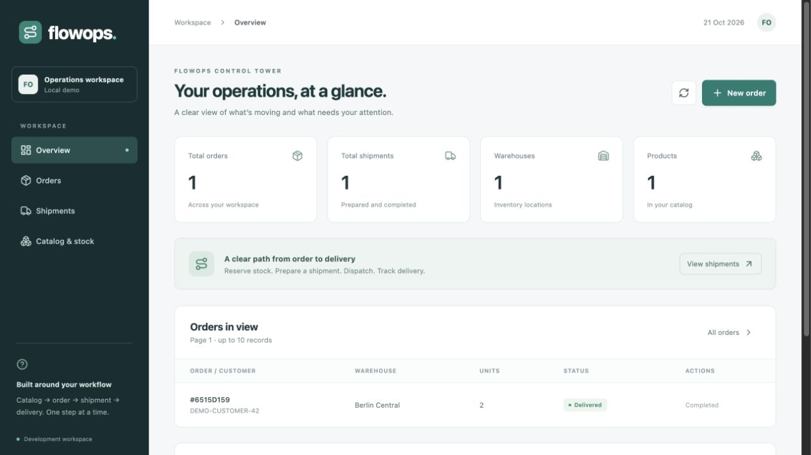
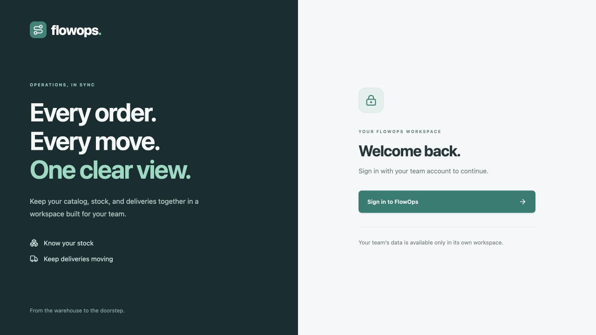

# FlowOps AI

A logistics platform being built step by step with Java 21 and Spring Boot.
The current milestone includes PostgreSQL-backed warehouse, product catalog, and
stock balances, movements, reservations, orders, shipment preparation, and dispatch.
Manual delivery updates, shipment history, and a React operations console are
implemented, with Keycloak sign-in and authenticated tenant isolation. Kafka, Ollama,
and Kubernetes remain future milestones.

## React operations console



The `frontend/` application includes Overview, Orders, Shipments, and Catalog &
stock screens, plus the complete create/reserve/prepare/dispatch/deliver flow.
Order numbers open full detail snapshots. Catalog stock rows support receipts,
adjustments, balance previews, and movement history. The console displays real
API records, with empty, loading, and error states. The screenshot
shows records created in an isolated QA database; they are not automatically seeded.

Start the backend below, then in another terminal:

```sh
cd frontend
npm ci
npm run dev
```

Open Vite's printed Local URL, normally http://127.0.0.1:5173. See the
[frontend guide](frontend/README.md) for first-use steps, proxy configuration,
checks, and current limits. React uses [Vite](https://vite.dev/guide/) as its build
and local development server, following the [React setup guidance](https://react.dev/learn/build-a-react-app-from-scratch).

## Run locally

Prerequisites: Java 21 and a running Docker engine. Use the included Maven wrapper.

```sh
docker compose -f docker/compose.yaml up -d --wait
./mvnw spring-boot:run
```

The API runs on port 8080. PostgreSQL is exposed on localhost port 5433.
Keycloak runs at http://localhost:8082 and imports the local FlowOps realm on its
first start. Sign in to the React console with either local test account below.
Restart any older backend process so it loads the new authentication boundary.
Flyway applies migrations automatically; Hibernate validates the resulting schema.
Existing migration files must remain unchanged once applied; add a new migration for schema changes.

Optional database settings: `DB_URL`, `DB_USERNAME`, and `DB_PASSWORD`.
Defaults match the local Compose database. The Compose password is for local development.

Stop the local services without deleting their data:

```sh
docker compose -f docker/compose.yaml stop
```

## Sign-in and organization isolation



| Local account | Password | Organization |
| --- | --- | --- |
| `berlin.operator` | `flowops_local_only` | `11111111-1111-4111-8111-111111111111` (existing demo data) |
| `hamburg.operator` | `flowops_local_only` | `22222222-2222-4222-8222-222222222222` (separate records) |

These are public, local development credentials. The Compose ports bind to
loopback. Sign out before switching accounts; Berlin's records should disappear
when signed in as Hamburg. No business records are seeded by the realm import.
The local Keycloak administrator is `local-admin` / `local_admin_only`.

Browser QA on a separate database confirmed an authenticated Berlin warehouse
write, successful logout, and an empty warehouse list after signing in as Hamburg.
[Berlin workspace](docs/images/authenticated-workspace.png) ·
[Hamburg workspace](docs/images/tenant-isolation.png).

React uses authorization code with PKCE. The backend checks the signature, issuer,
expiry, API audience (`flowops-api`), subject, and UUID tenant claim. Only identity
administrators can assign `tenant_id`; end users cannot edit it in their profile.
`GET /api/v1/session` returns the verified subject, username, and tenant ID for the
signed-in console. `/actuator/health` remains public; `/api/v1/health` requires login.

To use the curl examples, set `ACCESS_TOKEN` to the short-lived access token from
your own signed-in browser request (Network tab, Authorization header, omit the
`Bearer ` prefix), or obtain one with an OAuth client using authorization code +
PKCE. Keep tokens out of source control, shared logs, and screenshots. Password
grants are disabled. Requests without a token intentionally return `401`.

Configuration: backend `OIDC_ISSUER_URI` and `OIDC_AUDIENCE`; optionally
`OIDC_JWK_SET_URI` for a separately reachable signing-key endpoint (issuer checks
still apply). Frontend `VITE_OIDC_AUTHORITY` and `VITE_OIDC_CLIENT_ID` are public
build-time settings. Defaults match Compose. See the
[identity setup guide](docker/keycloak/README.md) for claim ownership and local reset.

This milestone gives every authenticated tenant member the same operational
permissions. Role restrictions, per-action actor audit fields, and production
identity deployment are upcoming work. Existing JWTs remain valid until their
short expiry even after provider logout; there is no token revocation lookup.

## Try the warehouse API

```sh
curl -i -H "Authorization: Bearer $ACCESS_TOKEN" http://localhost:8080/api/v1/health
curl -i http://localhost:8080/actuator/health
curl -i -H "Authorization: Bearer $ACCESS_TOKEN" -X POST http://localhost:8080/api/v1/warehouses \
  -H 'Content-Type: application/json' \
  -d '{"name":"Berlin Central","city":"Berlin","countryCode":"de"}'
curl -i -H "Authorization: Bearer $ACCESS_TOKEN" http://localhost:8080/api/v1/warehouses
```

Creation returns `201 Created` and a `Location` header. Follow that URL to fetch
the warehouse. Repeating a name (case insensitive, within the same tenant) returns
`409`. Invalid input returns `400`; an unknown warehouse returns `404`.
Errors have the shape `{"error":"description"}`.

| Method | Endpoint | Behavior |
| --- | --- | --- |
| GET | `/api/v1/health` | Application identification |
| GET | `/actuator/health` | Application and database health |
| POST | `/api/v1/warehouses` | Create a warehouse |
| GET | `/api/v1/warehouses` | List signed-in tenant warehouses |
| GET | `/api/v1/warehouses/{id}` | Fetch a warehouse for the signed-in tenant |

All business endpoints require a valid bearer access token. The API derives the
organization from the verified `tenant_id` claim; headers, query parameters, and
request bodies cannot select a different tenant. Missing/invalid credentials return
`401`, and another tenant's record IDs return `404` through scoped service queries.

## Try the product catalog

A product identifies what can be stored or shipped. Its SKU is unique within a
tenant and normalized to uppercase. Warehouse stock quantities are tracked separately from the product catalog.

```sh
curl -i -H "Authorization: Bearer $ACCESS_TOKEN" -X POST http://localhost:8080/api/v1/products \
  -H 'Content-Type: application/json' \
  -d '{"sku":"laptop-001","name":"Business laptop","weightKg":1.250}'
curl -i -H "Authorization: Bearer $ACCESS_TOKEN" http://localhost:8080/api/v1/products
```

| Method | Endpoint | Behavior |
| --- | --- | --- |
| POST | `/api/v1/products` | Create a product; returns `201` and its `Location` |
| GET | `/api/v1/products` | List signed-in tenant products ordered by SKU |
| GET | `/api/v1/products/{id}` | Retrieve a signed-in tenant product |

Follow the creation response's `Location` to retrieve the product. SKU supports
1–64 ASCII letters, digits, dots, underscores, or hyphens, starting with a letter
or digit. Leading and trailing spaces are trimmed from SKU and name. Name is
required and limited to 150 characters after trimming. `weightKg` is required,
positive, and supports at most six integer and three decimal digits (0.001 to
999999.999). Decimal storage avoids binary floating point rounding in weights.

Duplicate SKU returns `409`, invalid input `400`, and unknown or another tenant's
product `404`. Products use the same verified tenant as warehouses. The list is unpaginated for this initial demo; pagination
is needed before supporting large catalogs.

## Initialize warehouse stock

Create a warehouse and product first using the examples above, then copy their
IDs into these variables:

```sh
WAREHOUSE_ID='<warehouse UUID from the response>'
PRODUCT_ID='<product UUID from the response>'
curl -i -H "Authorization: Bearer $ACCESS_TOKEN" -X POST "http://localhost:8080/api/v1/warehouses/$WAREHOUSE_ID/stock" \
  -H 'Content-Type: application/json' \
  -d "{\"productId\":\"$PRODUCT_ID\",\"initialQuantity\":25}"
curl -i -H "Authorization: Bearer $ACCESS_TOKEN" "http://localhost:8080/api/v1/warehouses/$WAREHOUSE_ID/stock"
curl -i -H "Authorization: Bearer $ACCESS_TOKEN" "http://localhost:8080/api/v1/warehouses/$WAREHOUSE_ID/stock/$PRODUCT_ID"
```

| Method | Endpoint | Behavior |
| --- | --- | --- |
| POST | `/api/v1/warehouses/{warehouseId}/stock` | Initialize a product's stock; returns `201` and `Location` |
| GET | `/api/v1/warehouses/{warehouseId}/stock` | List that warehouse's stock ordered by product ID |
| GET | `/api/v1/warehouses/{warehouseId}/stock/{productId}` | Retrieve that product's stock |

`initialQuantity` is a required nonnegative integer, up to 2147483647. Fractional
JSON quantities are rejected instead of silently truncated. Opening stock can be
zero. Responses include `onHand`, `reserved`, and `available = onHand - reserved`.
`reserved` starts at zero. A version field tracks balance updates. Movement transactions lock the stock row
to serialize concurrent changes.

Opening stock can be created only once per tenant/warehouse/product. A repeated or
simultaneous duplicate request returns `409` and never resets the quantity. The
warehouse and product must both belong to the current signed-in tenant; missing or
inaccessible references return `404`. An existing warehouse without stock returns
an empty list; looking up an uninitialized product's stock returns `404`.

The database enforces nonnegative stock, `reserved <= onHand`, and a unique stock
record per tenant/warehouse/product. Warehouse and product references are checked
through their service boundaries; there are no cross-module foreign keys. Deletion
of warehouses/products is not exposed. Referential cleanup will need a defined
workflow if deletion is introduced. Lists remain unpaginated for the local demo.

Opening stock also creates an `OPENING` audit entry. Migration V5 backfills an
opening entry from each existing stock balance, preserving its original creation
time. Historical changes made outside FlowOps before that migration cannot be
reconstructed. Business APIs use the tenant from the verified access token.

## Record receipts and adjustments

Once stock is initialized, post changes to its movements endpoint. A receipt adds
units; an adjustment uses a signed quantity to record a correction. Both require a
reason. For example, a receipt of 10 and a damage adjustment of -3 change a balance
of 25 to 32.

```sh
REQUEST_ID=$(uuidgen)
curl -i -H "Authorization: Bearer $ACCESS_TOKEN" -X POST "http://localhost:8080/api/v1/warehouses/$WAREHOUSE_ID/stock/$PRODUCT_ID/movements" \
  -H 'Content-Type: application/json' \
  -d "{\"requestId\":\"$REQUEST_ID\",\"type\":\"RECEIPT\",\"quantity\":10,\"reason\":\"Delivery received\"}"
curl -i -H "Authorization: Bearer $ACCESS_TOKEN" "http://localhost:8080/api/v1/warehouses/$WAREHOUSE_ID/stock/$PRODUCT_ID/movements"
```

| Method | Endpoint | Behavior |
| --- | --- | --- |
| POST | `/api/v1/warehouses/{warehouseId}/stock/{productId}/movements` | Apply a receipt or adjustment; new movement returns `201` |
| GET | `/api/v1/warehouses/{warehouseId}/stock/{productId}/movements` | List movement history ordered by creation time and ID |

- `requestId`: client-generated UUID, unique per stock record. Reuse it when retrying the same operation.
- `type`: `RECEIPT` (positive quantity) or `ADJUSTMENT` (positive or negative, never zero). `OPENING` is created internally.
- `quantity`: signed integer within the 32-bit range. Fractional values are rejected.
- `reason`: required, trimmed, and limited to 250 characters.

Identical retries return `200` with the original movement and its original balance
snapshot, even after subsequent changes. Reusing the request ID with a different
type, quantity, or normalized reason returns `409`. Generate a new ID for a genuinely
new change; generating a new ID on every retry would apply the quantity again.

Each movement returns its ID, stock ID, request ID, type, signed quantity, before
and after balances, reason, and timestamp. Read the stock endpoint for the current
balance. Adjustments that would reduce `onHand` below `reserved` or overflow the
integer capacity return `409` without writing a movement. Invalid payloads return
`400`; inaccessible warehouses or missing stock return `404`.

Balance changes and movement insertion commit in one database transaction. Row
locking prevents lost updates and serializes duplicate checks. The database also
enforces request uniqueness and valid movement arithmetic. Audit history has no
update/delete API; database administrators can still modify it. Per-operation actor attribution remains a separate future migration. History is unpaginated for this local demo.

## Reserve and release inventory

A reservation holds units without changing physical stock. All items must have
initialized stock in the same tenant-owned warehouse. A hold either succeeds for
every line or changes nothing.

```sh
RESERVATION_REQUEST_ID=$(uuidgen)
curl -i -H "Authorization: Bearer $ACCESS_TOKEN" -X POST "http://localhost:8080/api/v1/warehouses/$WAREHOUSE_ID/reservations" \
  -H 'Content-Type: application/json' \
  -d "{\"requestId\":\"$RESERVATION_REQUEST_ID\",\"items\":[{\"productId\":\"$PRODUCT_ID\",\"quantity\":2}]}"
```

Copy the reservation ID from the response, then retrieve or release it:

```sh
RESERVATION_ID='<reservation UUID from the response>'
curl -i -H "Authorization: Bearer $ACCESS_TOKEN" "http://localhost:8080/api/v1/warehouses/$WAREHOUSE_ID/reservations/$RESERVATION_ID"
curl -i -H "Authorization: Bearer $ACCESS_TOKEN" -X POST "http://localhost:8080/api/v1/warehouses/$WAREHOUSE_ID/reservations/$RESERVATION_ID/release"
```

| Method | Endpoint | Behavior |
| --- | --- | --- |
| POST | `/api/v1/warehouses/{warehouseId}/reservations` | Hold all items; `201` with `Location`, or `200` for an identical retry |
| GET | `/api/v1/warehouses/{warehouseId}/reservations/{reservationId}` | Read status, original items, and timestamps |
| POST | `/api/v1/warehouses/{warehouseId}/reservations/{reservationId}/release` | Return all held units; `200`, including repeated release |

`requestId` is a required UUID scoped to the tenant and warehouse. `items` must
contain 1–50 distinct product UUIDs with positive integer quantities. Retrying the
same ID and items (in any order) returns the current reservation without reserving
again. Different items with the same ID return `409`. Replaying a released
reservation returns `RELEASED` and does not reopen it.

`onHand` stays unchanged; `reserved` increases on creation and decreases on release.
Insufficient free units return `409`; invalid/duplicate items return `400`; missing
or out-of-scope warehouses, stock, and reservation lookups return `404`. Every
stock row is locked in consistent product-ID order. Different requests with the
same retry key are also protected by a database unique constraint.

Standalone reservations require explicit full release and do not expire automatically.
Order-created reservations expose an `ownerOrderId`; release these through order
cancellation. Direct release or standalone retry of an order-owned reservation
returns `409`. Partial release and actor attribution remain future work. Dispatch consumes an
order-owned hold; consumed units cannot be released. Reservation creation/release emit operational logs
after commit; DEBUG logging adds replay/lookup details. See the
[development guide](docs/DEVELOPMENT_GUIDE.md) for a code walkthrough, comments,
transaction handling, logging conventions, and how to enable DEBUG locally.

## Create and cancel orders

Orders use the existing catalog and warehouse stock. Order creation and its owned
reservation commit together: insufficient stock or any write failure leaves no
order, reservation, or partial hold. Orders manage fulfillment quantities, not pricing, tax, payments, or delivery addresses.

```sh
ORDER_REQUEST_ID=$(uuidgen)
curl -i -H "Authorization: Bearer $ACCESS_TOKEN" -X POST http://localhost:8080/api/v1/orders \
  -H 'Content-Type: application/json' \
  -d "{\"requestId\":\"$ORDER_REQUEST_ID\",\"warehouseId\":\"$WAREHOUSE_ID\",\"customerReference\":\"DEMO-CUSTOMER-42\",\"items\":[{\"productId\":\"$PRODUCT_ID\",\"quantity\":2}]}"
ORDER_ID='<order UUID from the response>'
curl -i -H "Authorization: Bearer $ACCESS_TOKEN" "http://localhost:8080/api/v1/orders/$ORDER_ID"
curl -i -H "Authorization: Bearer $ACCESS_TOKEN" 'http://localhost:8080/api/v1/orders?page=0&size=20'
curl -i -H "Authorization: Bearer $ACCESS_TOKEN" -X POST "http://localhost:8080/api/v1/orders/$ORDER_ID/cancel"
```

| Method | Endpoint | Behavior |
| --- | --- | --- |
| POST | `/api/v1/orders` | Create order plus hold; `201` with `Location`, or `200` on identical replay |
| GET | `/api/v1/orders/{orderId}` | Read order, original product snapshots, and reservation ID |
| GET | `/api/v1/orders?page=0&size=20` | List tenant orders with pagination metadata |
| POST | `/api/v1/orders/{orderId}/cancel` | Cancel and release the hold together; repeated cancellation returns `200` |

Input requires a request UUID, warehouse UUID, trimmed customer reference of 1–100
characters, and 1–50 distinct product UUIDs with positive integer quantities.
The warehouse, products, and stock must be accessible within the signed-in tenant.
A customer reference is a correlation label, not a verified customer identity.

The request ID is unique per tenant. An identical retry (including reordered items)
returns the current order; changed warehouse, reference, or quantities return `409`.
A cancelled order stays cancelled on replay. Use a new request ID for a new order.
Concurrent identical requests produce one order and one hold. Competing orders
cannot reserve more than the available units.

New orders return `CONFIRMED`, with physical stock unchanged and reserved units
increased. Cancellation returns `CANCELLED` plus a timestamp, releasing only that
order's units and cancelling any prepared shipment in the same transaction.
Once dispatched, cancellation returns `409`; a returns workflow is future work. Product SKUs and names are snapshotted so later catalog edits do not
rewrite order history. Unknown or other-tenant order IDs return `404`; malformed
input returns `400`; insufficient stock or conflicting retry details return `409`.

Pages use a zero-based nonnegative page number and a size from 1 to 100 (default
20), ordered by newest creation time then ID. The response includes `content`,
`page`, `size`, `totalElements`, and `totalPages`. Item snapshots are currently
loaded per order within a bounded page; batch fetching is a later optimization.

This modular monolith uses one local database transaction across module services.
Orders never directly access inventory tables. A temporary `PENDING` order row
claims the retry key, becomes confirmed after reservation, and rolls back on
failure. If modules become separate services, this transaction must be replaced
with an explicit saga/outbox design. No distributed consistency is claimed yet.

## Prepare and dispatch shipments

Use a confirmed order from the previous step. If you already cancelled that order,
create a fresh order with a new request ID first. This milestone ships every item
in the order together; partial/split shipments are not supported.

```sh
curl -i -H "Authorization: Bearer $ACCESS_TOKEN" -X POST http://localhost:8080/api/v1/shipments \
  -H 'Content-Type: application/json' \
  -d "{\"orderId\":\"$ORDER_ID\",\"carrier\":\"Demo carrier\"}"
SHIPMENT_ID='<shipment UUID from the response>'
curl -i -H "Authorization: Bearer $ACCESS_TOKEN" "http://localhost:8080/api/v1/shipments/$SHIPMENT_ID"
curl -i -H "Authorization: Bearer $ACCESS_TOKEN" 'http://localhost:8080/api/v1/shipments?page=0&size=20'
curl -i -H "Authorization: Bearer $ACCESS_TOKEN" -X POST "http://localhost:8080/api/v1/shipments/$SHIPMENT_ID/dispatch"
```

| Method | Endpoint | Behavior |
| --- | --- | --- |
| POST | `/api/v1/shipments` | Prepare a full-order shipment; `201` plus `Location`, or `200` on replay |
| GET | `/api/v1/shipments/{shipmentId}` | Read shipment details and internal tracking number |
| GET | `/api/v1/shipments?page=0&size=20` | Tenant-scoped pages with the same bounds as orders |
| POST | `/api/v1/shipments/{shipmentId}/dispatch` | Dispatch once; retries return the current dispatched result with `200` |

`orderId` is required. `carrier` is a required, trimmed, case-sensitive label of
1–80 characters. Each tenant/order has at most one shipment. Repeating the same
order and carrier returns its current shipment, including after dispatch or
cancellation. Changing the carrier returns `409`; carrier editing is not exposed.
An order cancelled before shipment creation cannot receive a new shipment.

Preparation creates a `PREPARED` shipment with a unique internal `FLO-...` tracking
number. It leaves the order `CONFIRMED` and all quantities unchanged. The carrier
label and tracking number are demo data, not an external carrier booking or live
tracking integration.

Dispatch commits these changes together:

- Shipment becomes `DISPATCHED` with a timestamp.
- Order becomes `DISPATCHED` with a timestamp.
- Owned reservation becomes `CONSUMED`, recording the shipment ID and timestamp.
- Each item's quantity is subtracted from both physical and reserved stock.
- A negative `DISPATCH` stock movement records the shipment ID and before/after balance.

For example, `onHand=10`, `reserved=3`, `available=7` becomes `onHand=7`,
`reserved=0`, `available=7` when those three held units leave. Other orders' holds
remain untouched. Dispatch audit entries use a separate shipment key so public
receipt request IDs cannot collide with them. Clients cannot submit `DISPATCH`
through the generic stock movement API.

Cancelling a confirmed order also cancels its prepared shipment and releases its
hold. Cancellation and dispatch lock the order first, so only one can succeed when
they race. A cancelled shipment cannot dispatch; a dispatched order cannot cancel.
Stock is not restored by retrying a release after consumption. Missing/out-of-tenant
IDs return `404`; invalid input returns `400`; lifecycle conflicts return `409`.

Stock deductions, audit entries, reservation consumption, order status, and shipment
status use one local database transaction. Any write failure rolls the entire
operation back. Synchronous order-cancellation listeners participate in that same
transaction; commit-aware activity listeners log only successful changes. These
are in-process events, not durable Kafka messages. Carrier APIs, returns, and partial fulfillment remain future work.

## Delivery updates and shipment history

After dispatch, shipments progress through `DISPATCHED -> IN_TRANSIT -> DELIVERED`.
Operators use `POST /api/v1/shipments/{shipmentId}/status` with a request UUID,
`status` (`IN_TRANSIT` or `DELIVERED`), and a trimmed, nonblank `note` of up to 250
characters. Skipping or regressing states returns `409`. Delivery marks the order
`DELIVERED` in the same transaction; it does not deduct stock again.

Example body:

```json
{"requestId":"<new UUID>","status":"IN_TRANSIT","note":"Departed the distribution hub"}
```

`GET /api/v1/shipments/{shipmentId}/history` returns status events in sequence order.
Preparation, dispatch, and cancellation also create events. Migration V9 reconstructs
existing prepared/dispatched/cancelled events from stored timestamps without
inventing carrier updates. Notes are audit data and are excluded from application
logs. No public history edit/delete API exists.

An identical status request replay returns the original event with `200`, even if
the shipment has since progressed. Reusing its ID with another note/status returns
`409`. A new request ID targeting the same current status is a conflict. Late
retries of dispatch return the current shipment without repeating stock deductions.
History and status updates are tenant-scoped; an inaccessible ID returns `404`.
These are manual operator updates, not an external carrier webhook or GPS feed.

## Verify

```sh
./mvnw verify
```

Docker must be running. Testcontainers starts a disposable PostgreSQL 17 instance,
so tests do not require Compose or use your development database. The first run
may download the database image and Maven dependencies.

Tests cover the application context, warehouse service, HTTP creation/retrieval,
normalization, validation, malformed requests, duplicate names, the database
uniqueness constraint, and isolation of another tenant's records. Product tests also
cover SKU normalization, sorted listing, weight limits, and database constraints.
Stock tests cover opening balances, duplicate requests including simultaneous
submissions, tenant and warehouse isolation, invalid references, fractional and
negative quantities, and database stock invariants. Movement tests verify audit
history, replay behavior, rollback if audit insertion fails, reserved-stock and
overflow protection, concurrent changes, tenant isolation, and upgrades from V4.
Reservation tests cover multi-item rollback, competing holds, reordered retries,
repeated/concurrent release, reserved-stock protection, scope validation, and
success logging only after commit. Order tests cover atomic creation/cancellation,
concurrent retry and overselling protection, rollback across module boundaries,
tenant-scoped pagination, catalog snapshots, and preventing direct release of
order-owned reservations. Shipment tests cover dispatch accounting, audit and
state rollback, retry-key isolation, cancellation/dispatch races, concurrent
dispatch, tenant scope, and upgrading confirmed orders with active holds from V7.
Security tests additionally verify signed tokens, invalid credentials/claims, and
cross-tenant reads and writes; the business suite uses explicit authenticated fixtures.

## Structure

- `shipment`: preparation, tracking identifiers, full-order dispatch, cancellation coordination, and logs
- `order`: order lifecycle, product snapshots, pagination, inventory integration, and commit-aware logs
- `inventory`: balances, movements, reservations, lifecycle handling, and commit-aware activity logging
- `product`: product catalog controller, DTOs, service, entity, repository, and exceptions
- `security`: bearer-token validation, HTTP access rules, and session identity
- `security/CurrentTenant`: trusted tenant resolution at controller boundaries
- `warehouse/controller`: HTTP requests and responses
- `warehouse/dto`: validated input and public response fields
- `warehouse/service`: business operations and transaction boundaries
- `warehouse/entity` and `warehouse/repository`: PostgreSQL persistence
- `exception`: shared HTTP error handling
- `src/main/resources/db/migration`: versioned schema changes
- `docker`: local PostgreSQL and Keycloak infrastructure

## Next milestones

1. Add operator/viewer permissions and actor attribution to audit history.
2. Add reservation expiry coordinated with order cancellation.
3. Add Kafka with transactional outbox publishing and idempotent consumers.
4. Integrate local Ollama for shipment explanations; keep inventory decisions deterministic.
5. Add container packaging, Kubernetes manifests, CI, and observability.

Keep each milestone runnable and tested before moving to the next. Performance
and reliability claims belong in the portfolio only after measurement.
