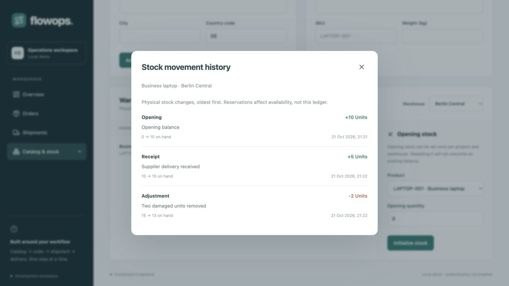

# FlowOps operations console

React + TypeScript + Vite, with ordinary CSS and Lucide icons. This is a real API
client for the Spring Boot application in the repository root; it has no mock-data
mode or external carrier integration.

## Start

Use Node.js 22.12 or newer. From the repository root, start PostgreSQL/Keycloak and **restart
Spring Boot on the current source** so the latest migrations and delivery APIs load:

```sh
docker compose -f docker/compose.yaml up -d --wait
./mvnw spring-boot:run
```

In a second terminal:

```sh
cd frontend
npm ci
npm run dev
```

Open the Local URL printed by Vite (normally http://127.0.0.1:5173). Port 5173 is
strict: if occupied, stop your old frontend process rather than silently running
a different instance. Existing backend data is displayed; records are not seeded.
Do not stop someone else's process to free a port.

The Vite server proxies `/api` to `http://127.0.0.1:8080`. To use a different local
backend, set the target when starting Vite:

```sh
API_TARGET=http://127.0.0.1:8081 npm run dev
```

The browser stays same-origin, so broad CORS permissions are unnecessary. This
proxy is a development/preview convenience, not production hosting. A production
server must serve the static build and reverse-proxy `/api` to Spring Boot.
The bundled identity provider is for local development. Production hosting needs
TLS and matching identity-provider redirect origins; see the root README.

## Sign in

Choose **Sign in** and use `berlin.operator` / `flowops_local_only`. This account
sees the existing demo organization. `hamburg.operator` with the same local password
belongs to a different organization and starts without records. `berlin.viewer`
with the same local password can browse Berlin records and history without write
controls. The API also rejects viewer commands, including requests outside the UI. Use **Sign out**
before switching. These seeded accounts are local test credentials only.

The default provider is `http://localhost:8082/realms/flowops` with client
`flowops-console`. Override using `VITE_OIDC_AUTHORITY` and `VITE_OIDC_CLIENT_ID`
before starting/building Vite. Redirects are the browser origin plus `/`; the bundled
realm permits only port 5173 on localhost and 127.0.0.1. `API_TARGET` changes only
the backend proxy, not the identity provider.

Tokens stay in memory. Reloading the page returns to sign-in, and the existing
provider session can complete it without re-entering credentials. Logout/expiry
removes the console and its loaded records. Temporary PKCE redirect state uses
session storage; no access or refresh token is persisted there or in local storage.
After a session expires during a write, check the latest server state before
starting a new command: the original operation may already have committed.

## First workflow

1. Open **Catalog & stock**, add a warehouse and a product.
2. Select the warehouse and initialize opening stock for the product.
3. Choose **New order**, enter a customer reference and positive quantities.
4. In **Orders**, prepare a shipment with a carrier label.
5. In **Shipments**, dispatch it, then mark it in transit and delivered with notes.
6. Select the tracking number or **View history** to see its timeline.
7. Select an order number to read its original product snapshots, reservation ID,
   and lifecycle timestamps.
8. In **Catalog & stock**, use **Record movement** for receipts or signed adjustments,
   and **History** to inspect physical balance changes.

Order cancellation asks for confirmation and releases stock through the backend.
Dispatch asks for confirmation because it deducts physical stock and prevents
cancellation. UI actions reflect the known lifecycle, while the server remains the
authority and rejects stale or conflicting commands.

## Checks

```sh
npm test
npm run build
```

Tests cover real API error handling, displayed API totals, offline state, retry-key
preservation after failed order submission, delivery transition selection, and
escaping history notes as plain text. The production build performs TypeScript
checking before bundling. `npm run preview` serves the build for local inspection.

## Code map

- `types.ts`: typed public API contracts.
- `auth.ts` / `AuthGate.tsx`: OIDC redirects, verified session, login screen, and workspace lifecycle.
- `apiSession.ts`: in-memory bearer token and account-wide request cancellation.
- `api.ts`: authenticated fetch, JSON parsing, and actionable server/network errors.
- `App.tsx`: navigation, paginated resources, tables, and action orchestration.
- `forms.tsx`: catalog, stock, order, shipment, delivery, and physical movement forms.
- `details.tsx`: canonical order snapshots and stock movement ledger dialogs.
- `useResource.ts`: abortable reads with stale-response protection and explicit retry.
- `components.tsx`: status badges, accessible dialogs, paging, history, mutation state.
- `styles.css`: shared visual tokens and responsive layout breakpoints.

Read requests are aborted when a page is replaced. Mutation forms disable submit
while pending and keep errors beside the form. Order/status forms retain an
idempotency key for an unchanged payload while the form remains open. After an
ambiguous connection failure, retry there rather than closing and starting another
order. Browser-persistent draft recovery is future work. Refresh reloads real data;
there is no live push channel yet.

The overview shows server-reported order/shipment totals. Tables and activity show
the current page; no delivery-rate or other aggregate metrics are invented. Catalog
lists are currently unpaginated, matching the backend's local-demo API. Full catalog editing and automatic/live tracking are later milestones.

## Inventory changes and detail views



Order numbers open the server's current order detail, rather than reusing a list
row. Product names and SKUs come from the original order snapshot. Errors provide
a retry action without closing the dialog.

Stock movements load the current product/warehouse balance. Receipts require a
positive quantity; adjustments use a nonzero signed quantity. A reason is required
and is retained in the audit ledger. The preview shows resulting physical and free
units. The server remains authoritative if stock changes concurrently.

New deductions that would consume reserved stock, or additions exceeding integer
capacity, are rejected by the form. An exact retry of a previously submitted
command is sent with its original key even after refreshing the balance: a
response-lost command may already be reflected in that balance, and only the
server can distinguish a replay from a new change. Keep that form open after an
ambiguous network failure rather than starting a new command.

History displays opening balances, receipts, adjustments, and shipment deductions
with signed quantities, reasons, timestamps, and before/after balances. Reasons
are rendered as plain text. Reservations are not physical movements and therefore
do not appear in this ledger. Read and write failures are shown explicitly.

## Permissions and recorded actors

`/session` supplies the verified application roles. Only operators see catalog
forms, new-order, movement, cancellation, dispatch, or delivery controls. Viewers
keep navigation, paging, order details, stock selection, and history. An account
with no recognized role stays at the sign-in boundary with an administrator action.

Movement and shipment timelines show the operator name captured with each entry,
falling back to its immutable subject. Issuer and subject are available as a tooltip. Values render as plain text.
Historical/non-user entries display **Not recorded**, without inventing an actor.
Changing an operator's display name does not rewrite past history.
